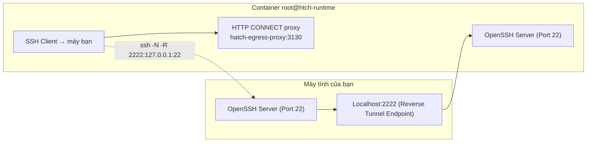

# MUSE_SSH_SETUP_GUIDE.md — phân tích mạng ngầm (tài liệu tham chiếu)

> **Trạng thái: tài liệu tham chiếu về *kiến trúc mạng*, không phải hướng dẫn cài đặt.**
> Hướng dẫn cài đặt hiện hành: [`README.md`](README.md) (bước 1–3) và [`LOCAL_AGENT.md`](LOCAL_AGENT.md).
> Quy trình phía container: [`MUSE_AGENT.md`](MUSE_AGENT.md) · Giao thức: [`PROTOCOL.md`](PROTOCOL.md).
>
> Bản gốc của file này mô tả thiết kế cũ (`muse-auto-ssh v1`) — script `reverse-tunnel-g3.sh`,
> `muse-reverse-tunnel.service` và "Heartbeat Worker" đã bị thay bằng `muse-bridge` (xem
> `legacy/README.md`). Phần **kiến trúc mạng** bên dưới vẫn đúng và vẫn hữu ích khi debug.

---

## 1. Vì sao phải làm reverse tunnel



1. **Outbound-Only:** node Tailscale của Muse do hypervisor của Meta quản lý dạng **client-only**.
   Mọi kết nối inbound trực tiếp vào cổng 22 của Muse đều bị từ chối (`Connection refused`).
2. **Sandbox container:** Muse chạy trong container Linux (`htch-runtime`), ra Tailnet qua HTTP
   CONNECT proxy nội bộ `hatch-egress-proxy` (cổng `3130`, có thể `3128`).
3. **Giải pháp:** Muse chủ động SSH **ra ngoài** tới máy bạn và mở cổng ngược
   (`127.0.0.1:2222` → sshd trong container). Máy bạn chỉ cần `ssh -p 2222 root@127.0.0.1`.

## 2. Ba điều kiện dễ vướng

| Vấn đề | Biểu hiện | Cách xử lý |
|---|---|---|
| Container không ra ngoài thẳng được | `ssh: connect to host … Operation not permitted` | Phải qua HTTP CONNECT proxy. `user:pass` nằm trong `HTTPS_PROXY` — thường **không có trong env** của agent, mà nằm trong `/proc/<pid>/environ` của tiến trình Hatch. Script `bridge/ts-socat-proxy.sh` tự dò cả proxy lẫn credential. |
| `sshd` của container treo | `banner exchange timeout` từ `127.0.0.1:2222` | `pgrep sshd` **không đủ** — phải kiểm tra sshd thật sự trả lời banner. Watchdog v3 làm đúng việc này. |
| `sshd` đọc file key khác `~` của agent | `Permission denied` dù đã ghi `~/.ssh/authorized_keys` | `sshd` chạy user `root` → đọc `/root/.ssh/authorized_keys`. Ghi key vào **cả hai** file. |

## 3. Tự phục hồi (thiết kế hiện hành)

Bốn lớp, chi tiết ở [`PROTOCOL.md`](PROTOCOL.md) mục 8.2:

1. **systemd service** `muse-reverse-tunnel-<port>.service` — supervisor chính, `Restart=always`.
2. **Watchdog v3** trong Hatch boot hook (`/home/hatch/hooks/scripts/muse-platform-boot.sh`, Hatch gọi
   mỗi 15s) — restart `sshd` khi treo, mở loop khi systemd chưa chạy.
3. **Loop `reverse-tunnel-<port>.sh`** — mỗi 10s thử lại `ssh -R`; mỗi host một cổng và **một config
   riêng** (`tunnel-<port>.conf`).
4. **Auto-repair qua web** — `bridge.sh repair --host <id>` gửi tin vào chat `muse.ai` để đánh thức
   container bị đóng băng (lớp 1–3 không chạy được khi container không chạy).

## 4. SSH client alias trên máy bạn

Alias do `bridge.sh add-host` tự sinh trong `~/.ssh/config` (mỗi Muse host một alias + một cổng):

```ssh-config
# Muse Reverse SSH Tunnel - muse2
Host muse2
    HostName 127.0.0.1
    Port 2223
    User root
    IdentityFile ~/.ssh/id_ed25519
    StrictHostKeyChecking no
    UserKnownHostsFile /dev/null
    LogLevel ERROR
```

Xem tất cả alias: `bash scripts/bridge.sh hosts`.
