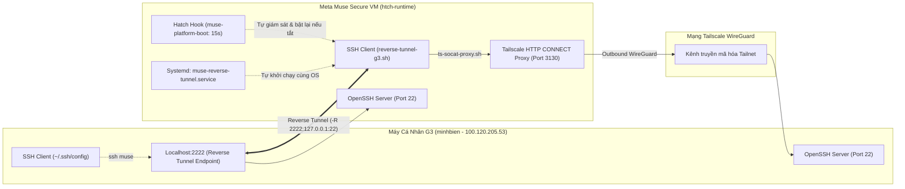

# Hướng Dẫn Chi Tiết Thiết Lập SSH 2 Chiều Tự Động Với Meta Muse AI (Tailscale & Reverse Tunnel)

Tài liệu này ghi lại toàn bộ cơ chế kỹ thuật, kiến trúc mạng ngầm và quy trình tự động hóa kết nối SSH 2 chiều giữa máy tính cá nhân Linux (**minhbien-G3-3500**) và máy ảo **Meta Muse Secure VM** (`htch-runtime`). Hệ thống được thiết lập cơ chế **Self-Healing**, đảm bảo kênh kết nối luôn duy trì tự động mà không cần can thiệp thủ công.

---

## 1. Bản Chất Kiến Trúc Mạng Của Muse Secure VM



### Tại sao cần Reverse SSH Tunnel?
1. **Thiết kế Outbound-Only:** Node Tailscale của Muse do hệ thống hypervisor của Meta quản lý dạng **client-only**. Mọi kết nối inbound trực tiếp vào cổng 22 của Muse đều bị từ chối (`Connection refused`).
2. **Sandbox Container:** Muse chạy trong container Linux (`htch-runtime`), giao tiếp ra Tailnet thông qua HTTP CONNECT proxy nội bộ (`hatch-egress-proxy` cổng `3130`).
3. **Giải pháp cốt lõi:** Muse chủ động SSH ra ngoài tới máy G3 (`100.120.205.53:22`) và mở một cổng ngược (`127.0.0.1:2222`) trỏ về SSH server nội bộ của Muse. Khi đó, máy G3 chỉ cần kết nối vào `localhost:2222` là vào thẳng máy ảo Muse.

---

## 2. Cơ Chế Tự Động Hóa "Phía Muse Luôn Luôn Sống"

Để phía Muse luôn sẵn sàng và **tự động kết nối lại ngay lập tức khi máy G3 mở SSH**:

### A. Vòng lặp tự động kết nối lại (`reverse-tunnel-g3.sh`)
- Sử dụng vòng lặp `while true` với `sleep 10`.
- Khi máy G3 tắt máy hoặc tắt `sshd`, lệnh SSH trên Muse sẽ kết thúc cleanly và chuyển sang trạng thái chờ.
- **Ngay khi máy G3 bật OpenSSH Server**, trong vòng tối đa **10 giây**, Muse sẽ tự động kết nối và mở lại cổng `2222`.
- Tham số cấu hình:
  - `ServerAliveInterval=15` và `ServerAliveCountMax=3`: Tự động ngắt và kết nối lại sau 45s nếu rớt mạng ngầm.
  - `ExitOnForwardFailure=yes`: Thoát ngay để thử lại nếu cổng 2222 bị kẹt.
  - `ConnectTimeout=10`: Tránh treo lệnh kết nối.

### B. Tự động nhận diện Proxy Token (`ts-socat-proxy.sh`)
- Script tự động quét và lấy token xác thực proxy từ tiến trình runtime (`HTTPS_PROXY`), đảm bảo script chạy được trong mọi môi trường (systemd, cron, subshell không biến môi trường).

### C. Cơ chế tự phục hồi đa tầng (Self-Healing) trên Muse
Hệ thống được cài đặt 3 tầng bảo vệ để không bao giờ bị mất tunnel kể cả khi Muse VM bị restart/recycle:
1. **Systemd Service:** `muse-reverse-tunnel.service` được kích hoạt (`enabled`) trên `htch-runtime`.
2. **Hatch Hook (`muse-platform-boot.sh`):** Hatch daemon của Muse tự động chạy script này mỗi **15 giây** từ phân vùng lưu trữ bền vững (`/home/hatch` trên btrfs). Script kiểm tra nếu `sshd` hoặc `reverse-tunnel-g3.sh` chưa chạy thì sẽ tự động khởi động lại ngay.
3. **Heartbeat Worker (`HEARTBEAT.md`):** Muse giám sát định kỳ trạng thái tunnel.

---

## 3. Cấu Hình Hoàn Chỉnh Trên Máy Cá Nhân (G3)

### 1. Dịch vụ SSH Server
OpenSSH Server đã được cài đặt và cấu hình tự chạy cùng hệ thống:
```bash
sudo systemctl enable --now ssh
```

### 2. SSH Client Alias (`~/.ssh/config`)
Thêm vào file `~/.ssh/config` trên máy G3:
```ssh-config
# Muse Reverse SSH Tunnel
Host muse muse-1 muse-2 100.69.31.103 100.64.129.89 100.75.168.25
    HostName 127.0.0.1
    Port 2222
    User root
    IdentityFile ~/.ssh/id_ed25519
    StrictHostKeyChecking no
    UserKnownHostsFile /dev/null
    LogLevel ERROR
```

---

## 4. Hướng Dẫn Sử Dụng Hằng Ngày

Khi muốn kết nối vào máy ảo Muse, bạn chỉ cần mở Terminal trên máy G3 và gõ:

```bash
ssh muse
```

Bạn sẽ vào thẳng môi trường shell `root@htch-runtime` của Muse một cách nhanh chóng và an toàn.
