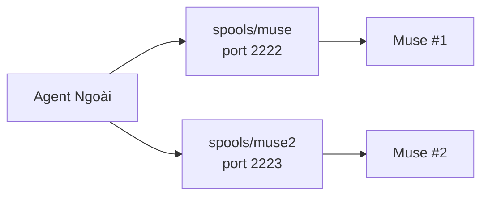
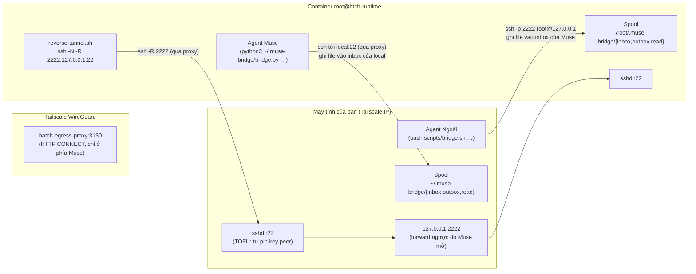
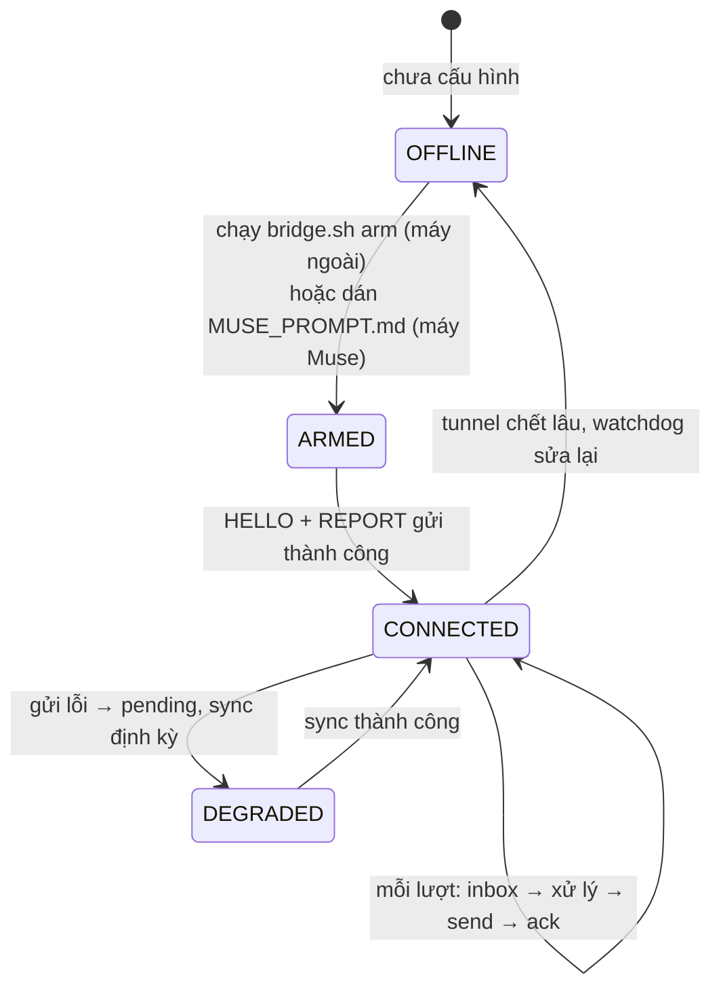
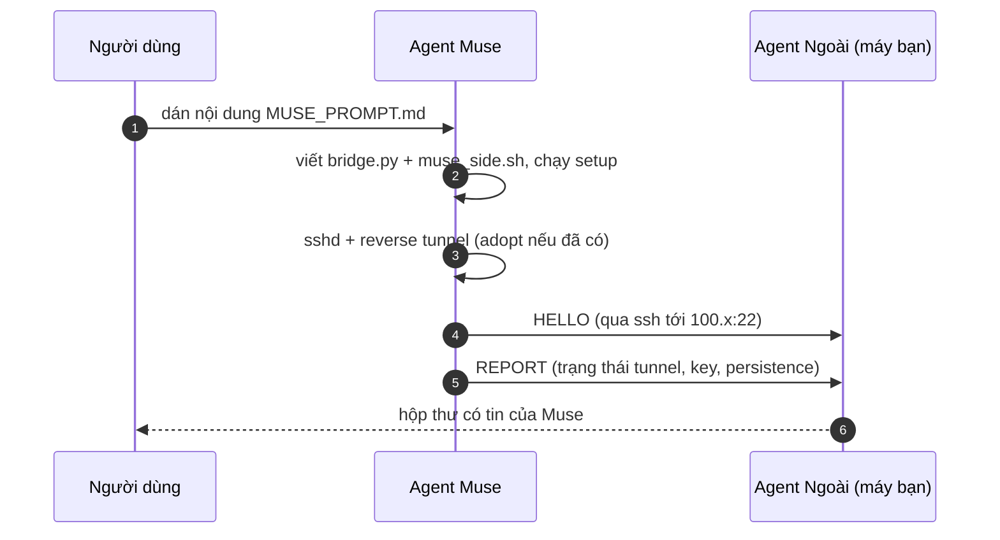
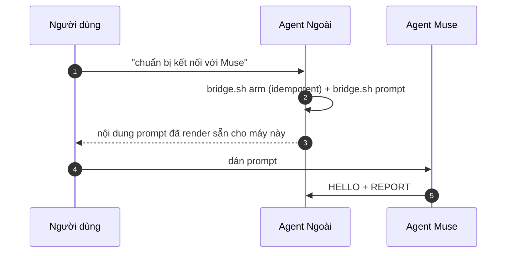
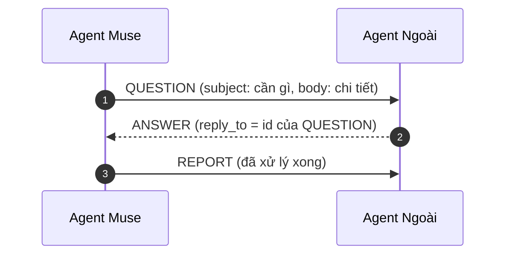
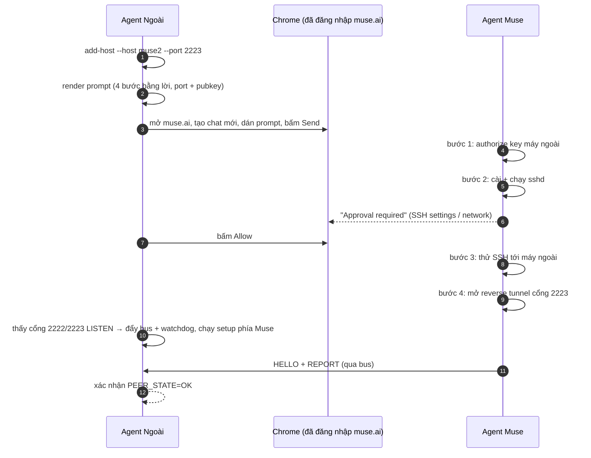

# PROTOCOL.md — `muse-bridge` v1

> **Hợp đồng giữa Agent Ngoài (máy tính của bạn) và Agent Muse (container Meta).**
> Đọc file này là hiểu ngay hai agent nói chuyện với nhau bằng cách nào, ai làm gì,
> và làm sao một lần dán prompt là chạy trọn.

---

## 1. Mục tiêu

Hai agent ở hai máy khác nhau (máy cá nhân ↔ container Muse, nối qua Tailscale) cần:

1. **Tự dựng kênh** mà không cần người dùng chép tay public key qua lại.
2. **Trao đổi tin nhắn hai chiều** (giao việc, hỏi đáp, báo cáo) — không phải trao đổi
   qua chat của người dùng.
3. **Tự phục hồi**: tunnel chết thì tự lên lại; tin nhắn gửi lỗi thì không mất.
4. **Một nguồn sự thật**: hai agent chạy *cùng một mã* (`bridge/bridge.py`).

---

## 2. Vai trò

| Vai trò | Chạy ở đâu | Làm gì |
|---|---|---|
| **Agent Ngoài** (`local`) | Máy tính của bạn (Linux/macOS/WSL) | Chuẩn bị máy, giữ kênh, đọc/gửi tin nhắn, trả lời khi Muse hỏi |
| **Agent Muse** (`muse`) | Container `root@htch-runtime` | Dựng tunnel, giữ kênh, đọc/gửi tin nhắn, báo cáo trạng thái, hỏi khi thiếu thông tin |

Cả hai đều là **agent AI**: mỗi bên có một vòng lặp "đọc hộp thư → xử lý → trả lời".

### 2.1. Nhiều Muse host trên cùng một máy

Một máy cá nhân có thể chạy **nhiều máy Muse** cùng lúc. Mỗi host được định danh bằng một `id`
(`muse`, `muse2`, `office-laptop`…) và có **riêng**:

| Thành phần | Quy ước | Ví dụ (`muse2`) |
|---|---|---|
| Cổng reverse-forward | `2222 + n` | `2223` |
| SSH alias | trùng `id` | `ssh muse2` → `127.0.0.1:2223` |
| Spool phía máy ngoài | `~/.muse-bridge/spools/<id>/` | `~/.muse-bridge/spools/muse2/` |
| Spool phía Muse | `/root/.muse-bridge/` (mỗi container một bản) | — |
| Thẻ thông tin kết nối | `.muse-hosts/<id>.json` **trong repo, gitignored** | không push lên git |

Runtime config: `~/.muse-bridge/hosts/<id>.json` (schema giống nhau, mỗi host một file).
Mọi lệnh của bus nhận `--host <id>`; tin nhắn có trường `host` để biết tin đó đến từ Muse nào.



---

## 3. Kiến trúc kênh



Ba nguyên tắc của kênh:

1. **Một kênh SSH duy nhất, hai chiều.** Muse mở *reverse tunnel* (`ssh -R 2222`) tới máy ngoài.
   Khi đó máy ngoài đã có `127.0.0.1:2222` → SSH server của Muse.
2. **Truyền tin = ghi file.** Không có server, không có port mới, không cần daemon ở giữa.
   `bridge.py send` chỉ là `ssh <peer> 'cat > <peer spool>/inbox/<id>.json'`.
3. **Chịu được sự cố.** Ghi file tạm rồi `mv` (atomic). Gửi hỏng → tin nằm ở `outbox/pending-*`,
   `bridge.py sync` gửi lại khi kênh sống lại.
4. **Một chiều vẫn dùng được (chế độ pull).** Container Muse có lúc không tạo được kết nối
   outbound (đang boot lại, egress bị chặn) → nó không gửi được tin ra máy ngoài. Khi đó máy ngoài
   **tự kéo** (`bridge.py pull`) tin từ `pending/` + `outbox/` của container qua chính kênh SSH đang
   chạy. Nhờ vậy bus vẫn hai chiều chỉ cần **một** chiều kênh còn sống.

---

## 4. Mô hình tin cậy (trust)

| Việc | Ai giữ | Ghi chú |
|---|---|---|
| Key của Agent Ngoài | `~/.ssh/id_ed25519` (máy bạn) | Public key được **đính kèm trong prompt** → Muse authorize ngược trong `authorized_keys` của nó. Chỉ có public key trong prompt. |
| Key của Agent Muse | `~/.muse-bridge/…` / `$BASE/keys/muse-agent-ed25519` (máy Muse) | Máy ngoài **tự động pin** (TOFU) khi Muse kết nối lần đầu. |
| TOFU | `bridge/authorize_peer.sh` (chạy bởi sshd) | Chỉ nhận peer có IP trong tailnet `100.64.0.0/10` / `fd7a:115c:a1e0::/48`. Key bị giới hạn: không PTY, không agent-forwarding, không X11. |

Cài TOFU (một lần, cần `sudo`):

```bash
sudo bash scripts/install_tofu_hook.sh
```

Sau đó **mọi máy Muse mới** đều tự được nhận — không còn copy/paste public key.

> Nếu chưa cài TOFU: hệ thống vẫn chạy với key đã được authorize sẵn; Muse mới sẽ báo
> `QUESTION` + `MUSE_PUBKEY` để Agent Ngoài thêm vào `~/.ssh/authorized_keys`.

---

## 5. Spool (hộp thư)

Mỗi bên có một thư mục spool:

```
~/.muse-bridge/            # máy ngoài: $HOME/.muse-bridge
/root/.muse-bridge/        # máy Muse
├── inbox/                 # tin nhắn gửi TỚI tôi (mỗi tin = 1 file .json)
├── outbox/                # bản sao tin tôi đã gửi
├── pending/               # tin gửi lỗi, chờ sync lại
├── read/                  # tin đã xử lý
├── logs/                  # log daemon
├── bridge.py              # bus core (mã nguồn chung)
├── config.json            # cấu hình: role, spool, peer
└── peers/                 # fingerprint key đã pin (TOFU)
```

Tên file = `<id>.json`, `id` = `<UTC timestamp>-<8 hex>` → sắp xếp theo thứ tự thời gian.

---

## 6. Envelope tin nhắn

```json
{
  "v": 1,
  "id": "20261106T093012Z-4f2a91c7",
  "ts": "2026-11-06T09:30:12Z",
  "from": "muse",
  "to": "local",
  "type": "REPORT",
  "subject": "Trạng thái Muse",
  "body": "MUSE_TUNNEL=ADOPTED/up …",
  "reply_to": null,
  "meta": { "MUSE_HOST": "htch-runtime" }
}
```

| Trường | Bắt buộc | Ý nghĩa |
|---|---|---|
| `v` | có | Phiên bản protocol (hiện tại `1`) |
| `id` | có | Định danh duy nhất, dùng để `ack` và `reply_to` |
| `ts` | có | Thời điểm gửi (UTC, ISO-8601) |
| `from` / `to` | có | `local` hoặc `muse` |
| `type` | có | Loại tin (bảng ở mục 7) |
| `subject` | không | Một dòng tóm tắt |
| `body` | không | Nội dung (text thuần; không phải JSON) |
| `reply_to` | không | `id` của tin được trả lời |
| `meta` | không | Cặp key/value tùy ý (trạng thái, số liệu) |

---

## 7. Loại tin (message types)

| `type` | Hướng | Ý nghĩa | Bắt buộc phản hồi? |
|---|---|---|---|
| `HELLO` | → | Bên kia vừa lên kênh, tự giới thiệu | Không (trả lời bằng `HELLO` là tốt) |
| `TASK` | → | Giao việc cụ thể | Có: `REPORT`/`NOTE` có `reply_to` |
| `QUESTION` | → | Cần thông tin/tài nguyên mà bên kia mới có | Có: `ANSWER` |
| `ANSWER` | → | Trả lời cho `QUESTION` (luôn kèm `reply_to`) | Không |
| `STATUS` | → | Trạng thái ngắn (kênh còn sống không) | Không |
| `REPORT` | → | Báo cáo kết quả/trạng thái chi tiết | Không |
| `NOTE` | → | Ghi chú, không cần phản hồi | Không |
| `BYE` | → | Kết thúc phiên làm việc | Không |

**Luật bắt buộc:** mọi tin `TASK`/`QUESTION` phải có một tin trả lời với `reply_to` trỏ về
`id` của nó — nếu không, bên gửi không biết việc đã xong hay chưa.

---

## 8. Vòng đời của mỗi bên



### 8.1. Ba rào chắn thực tế của nền tảng Muse (đã gặp, đã xử lý)

| Rào chắn | Biểu hiện | Cách xử lý trong thiết kế này |
|---|---|---|
| **Bộ lọc an toàn nội dung** | Agent từ chối chạy khối script lớn dán vào chat (05/11, 06/11) | Prompt **không chứa mã nguồn**, chỉ 4 bước ngắn bằng lời người dùng; mã do máy ngoài đẩy vào container sau khi kênh thông |
| **Cổng phê duyệt (approval)** | Hộp "Approval required: modify SSH settings / share information with…" chặn agent gửi tiếp | `muse_web.py` tự bấm **Allow once** (`muse_web.py approve`) |
| **Agent hỏi lại bằng lời** | "Bạn nói bằng lời của bạn bước nào bạn muốn mình làm trước" | Vòng lặp đối thoại trong `onboard`: đọc reply → authorize key nếu cần → gửi lệnh tiếp theo bằng lời tự nhiên |

Hệ quả: **mã nguồn chỉ đi qua kênh SSH đã xác thực**, không bao giờ đi qua hộp chat.

### 8.2. Bốn lớp tự phục hồi (đều đã kiểm chứng thật)

| Lớp | Chạy ở đâu | Cơ chế | Đã kiểm chứng |
|---|---|---|---|
| 1. **systemd service** `muse-reverse-tunnel-<port>.service` | container Muse | Chạy loop tunnel, `Restart=always`; sống qua cả lần container restart | ✅ trên cả 2 host |
| 2. **Watchdog v3** trong Hatch boot hook | container Muse | `sshd` phải **trả lời banner** (treo → restart); systemd chưa chạy → tự mở loop | ✅ cài trên cả 2 host |
| 3. **Loop `reverse-tunnel-<port>.sh`** | container Muse | Mỗi 10s thử lại `ssh -R`; tự restart `sshd` nếu treo | ✅ tunnel bị giết → tự lên lại sau ~15s |
| 4. **Auto-repair qua web** | máy ngoài | `bridge.sh repair --host <id>`: kênh chết → gửi tin nhắn vào chat Muse để **đánh thức container** bị đóng băng; daemon tự làm mỗi 5 phút | ✅ đánh thức được container, tunnel tự lên |

> Lý do cần lớp 4: nền tảng có thể **đóng băng (checkpoint) hoặc treo (suspend) container** — lúc đó
> không tiến trình nào trong container chạy, nên lớp 1–3 không thể chạy. Chỉ có thể đánh thức container
> từ bên ngoài (gửi tin nhắn vào chat `muse.ai` của nó), rồi lớp 1–3 lo phần còn lại.
>
> **Quan sát thực tế:** chat bên (side chat) của Muse có thể bị nền tảng treo khi lâu không dùng →
> container của nó ngừng chạy → tunnel rơi. Khi đó `bridge.sh repair` (hoặc daemon tự gọi mỗi 5 phút)
> gửi tin nhắn vào đúng chat đó → cell được đánh thức → tunnel tự lên lại. Nếu muốn container sống
> liên tục thì cần mở chat đó trên `muse.ai` (nền tảng giữ cell active khi chat đang mở).

---

## 9. Luồng nghiệp vụ

### Flow A — "Dán prompt một lần trên bất kì máy Muse nào"



Điều kiện: máy ngoài đã `arm` trước (đã có sshd + TOFU + config). Không cần relay thủ công.

### Flow B — "Máy tôi làm trước, rồi tự sinh prompt"



`bridge.sh prompt` render từ `templates/MUSE_PROMPT.template.md` + mã nguồn chung, nên **prompt
luôn khớp với mã đang chạy** — không bao giờ lệch phiên bản.

### Flow C — "Muse thiếu gì thì hỏi máy tôi"



### Flow D — "Giao việc"

`TASK` (máy ngoài → Muse) → Muse làm → `REPORT`/`NOTE` kèm `reply_to`.

---

### Flow E — "Zero-touch: agent tự dán prompt vào web Muse"

Người dùng **không phải copy/paste gì cả** — Agent Ngoài tự điều khiển trình duyệt:



Cơ chế điều khiển trình duyệt: `bridge/muse_web.py` — client CDP viết bằng Python chuẩn
(không cần thư viện ngoài). Nó **clone profile Chrome** (giữ cookie đăng nhập) và mở một Chrome
riêng với `--remote-debugging-port`, nên không chiếm phiên làm việc đang mở của người dùng.

## 10. Hợp đồng lệnh của mỗi bên

**Agent Ngoài** (chi tiết: `LOCAL_AGENT.md`). Mọi lệnh bus nhận `--host <id>`; bỏ trống thì dùng host
mặc định (đăng ký đầu tiên, hoặc host trong `~/.muse-bridge/default-host`):

```bash
bash scripts/bridge.sh hosts                          # liệt kê Muse host
bash scripts/bridge.sh add-host --host <id>           # đăng ký host mới (port, alias, spool)
bash scripts/bridge.sh arm      --host <id>           # chuẩn bị máy (1 lần / máy)
bash scripts/bridge.sh onboard  --host <id>           # zero-touch: tự dán prompt vào web Muse
bash scripts/bridge.sh prompt   --host <id>           # render prompt cho Muse
bash scripts/bridge.sh push     --host <id>           # đẩy mã mới lên container
bash scripts/bridge.sh provision --host <id>          # đẩy bus + watchdog + setup phía Muse
bash scripts/bridge.sh inbox    --host <id> [--watch] # đọc tin gửi tới
bash scripts/bridge.sh send     --host <id> --type TASK --subject "…" --body "…"
bash scripts/bridge.sh ack      --host <id> <id>      # đã xử lý
bash scripts/bridge.sh sync     --host <id>           # gửi lại tin pending
bash scripts/bridge.sh pull     --host <id>           # kéo tin từ peer (khi 1 chiều)
bash scripts/bridge.sh status   --host <id>           # trạng thái kênh
bash scripts/bridge.sh doctor                        # chẩn đoán tổng thể
bash scripts/bridge.sh repair   --host <id>           # đánh thức container bị đóng băng
bash scripts/bridge.sh daemon   --host <id>           # watcher nền (tuỳ chọn)
bash scripts/bridge.sh selftest                      # toàn bộ test offline + lint
```

**Agent Muse** (chi tiết: `MUSE_AGENT.md`):

```bash
python3 ~/.muse-bridge/bridge.py inbox
python3 ~/.muse-bridge/bridge.py send --type REPORT --subject "…" --body "…"
python3 ~/.muse-bridge/bridge.py ack <id>
python3 ~/.muse-bridge/bridge.py status
```

---

## 11. Xử lý sự cố

| Triệu chứng | Nguyên nhân | Cách xử lý |
|---|---|---|
| `PEER_STATE=DOWN` | Tunnel chết / sshd local tắt | Muse watchdog tự mở lại trong ≤10s; local: `sudo systemctl start ssh` |
| `QUEUED` khi gửi | Peer chưa sẵn sàng (hoặc container đang boot, egress bị chặn) | Không mất tin: nằm ở `outbox/pending-*`; `bridge.py sync` gửi lại, và phía máy ngoài có thể `bridge.py pull` để kéo tin từ peer |
| `Permission denied` khi Muse ssh vào local | TOFU chưa cài, key mới | `sudo bash scripts/install_tofu_hook.sh`, hoặc Muse gửi `QUESTION` kèm `MUSE_PUBKEY` |
| `Address already in use` (port 2222) | Tunnel cũ còn treo | Local: `ss -tlnp | grep 2222` → dừng tunnel cũ, rồi `bridge.sh push` |
| Tin không tới | Sai spool path giữa 2 bên | `bridge.sh status` in ra `SPOOL` và `PEER`; hai bên phải trùng `spool` |
| **sshd của Muse treo** (báo "banner exchange timeout", `127.0.0.1:2222` từ chối kết nối) | Container Muse bị đóng băng / treo tiến trình | Watchdog **v3** kiểm tra *banner* (không chỉ `pgrep`) nên tự restart được; nếu cả container không chạy (không có kết nối mới từ Muse) → **mở lại/recycle phiên Muse trong UI Meta**, container resume → hook 15s bật lại `sshd` + tunnel → `bash scripts/bridge.sh status` sẽ báo `PEER_STATE=OK` |

---

## 12. Mở rộng

- **Thêm loại tin**: thêm tên vào `MSG_TYPES` trong `bridge/bridge.py` (hai bên dùng chung mã →
  phải `bridge.sh push` để đồng bộ bản mới lên Muse).
- **Thêm trường**: dùng `meta` (không cần đổi schema).
- **Thêm năng lực cho Muse**: đặt lệnh vào `~/.muse-bridge/bundle/` trên máy Muse và gọi qua
  `bridge.py send --type TASK`.
- **Đổi cổng forward**: `REMOTE_PORT` trong `tunnel.conf` (Muse) và `peer.port` trong
  `config.json` (local) — phải khớp.

---

## 13. Phiên bản

`v: 1`. Khi đổi cấu trúc envelope hoặc bỏ bỏ loại tin → tăng `v` và hỗ trợ cả hai bên trong
thời gian chuyển tiếp. Bản hiện tại chỉ yêu cầu: **hai bên cùng chạy `bridge.py` giống nhau**.
