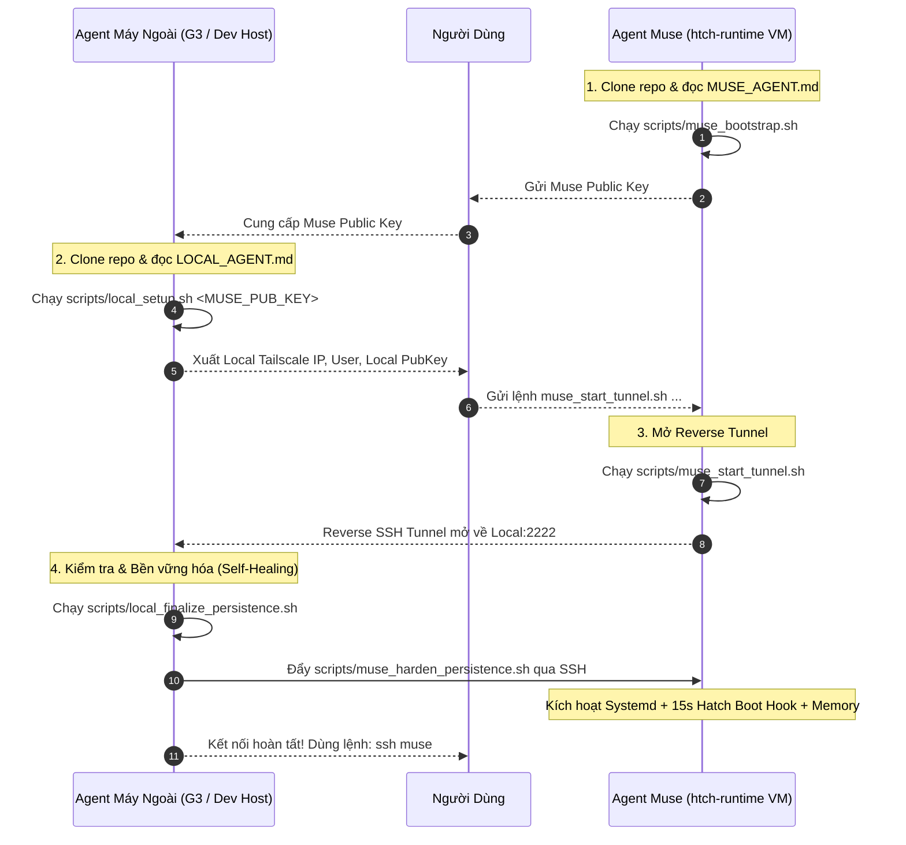

# Muse Auto SSH Bridge 🌉

Hệ thống tự động hóa thiết lập kênh kết nối SSH 2 chiều an toàn, bền vững và tự phục hồi (**Zero-Drop Self-Healing**) giữa **Máy tính cá nhân** và **Meta Muse Secure VM** (`htch-runtime`) qua mạng **Tailscale**.

Được thiết kế theo mô hình **Agent-to-Agent Collaboration**: AI Agent ở cả 2 đầu (Agent Máy Ngoài và Agent Muse) chỉ cần đọc file hướng dẫn tương ứng để tự động cấu hình và bắt tay với nhau.

---

## 🏗️ Kiến Trúc Hệ Thống



---

## 📂 Cấu Trúc Repository

```text
.
├── README.md                          # Tài liệu tổng quan
├── MUSE_AGENT.md                      # Hướng dẫn chi tiết dành riêng cho Agent Muse
├── LOCAL_AGENT.md                     # Hướng dẫn chi tiết dành riêng cho Agent Máy Ngoài
├── MUSE_SSH_SETUP_GUIDE.md            # Tài liệu phân tích chuyên sâu về mạng ngầm của Muse
├── scripts/
│   ├── muse_bootstrap.sh              # Bước 1 (Muse): Bật sshd, tạo/lấy Public Key Muse
│   ├── muse_start_tunnel.sh           # Bước 2 (Muse): Thêm key máy ngoài, mở reverse tunnel
│   ├── muse_harden_persistence.sh     # Bước 3 (Muse): Cài đặt Systemd & Hatch Boot Hook tự phục hồi
│   ├── local_setup.sh                 # Bước 1 (Máy ngoài): Chuẩn bị sshd, Tailscale IP, ~/.ssh/config
│   ├── local_finalize_persistence.sh  # Bước 2 (Máy ngoài): Test SSH & đẩy hardening vào Muse
│   └── templates/
│       ├── ts-socat-proxy.sh          # Proxy bridge có auto-discovery HTTPS_PROXY token
│       ├── reverse-tunnel.sh          # Loop tự reconnect mỗi 10s khi máy ngoài mở SSH
│       └── muse-reverse-tunnel.service# File dịch vụ systemd
```

---

## 🚀 Hướng Dẫn Sử Dụng Nhanh

### 1. Phía máy ảo Muse
Khi clone repo về máy ảo Muse, bảo Agent Muse:
> *"Hãy đọc file `MUSE_AGENT.md` và thực hiện theo hướng dẫn."*

Agent Muse sẽ chạy:
```bash
bash scripts/muse_bootstrap.sh
```
và gửi lại cho bạn chuỗi **Public Key** của Muse.

---

### 2. Phía máy tính cá nhân
Khi có Public Key của Muse, bảo Agent máy cá nhân:
> *"Hãy đọc file `LOCAL_AGENT.md` và chạy setup với key của Muse: `<MUSE_PUBLIC_KEY>`"*

Agent máy cá nhân sẽ chạy:
```bash
bash scripts/local_setup.sh "<MUSE_PUBLIC_KEY>"
```
và in ra câu lệnh để bạn gửi cho Agent Muse.

---

### 3. Khởi tạo đường hầm & Tự động bền vững hóa
1. Gửi lệnh xuất ra từ bước 2 cho Agent Muse chạy:
   ```bash
   bash scripts/muse_start_tunnel.sh <LOCAL_IP> <LOCAL_USER> "<LOCAL_PUB_KEY>"
   ```
2. Trên máy cá nhân, chạy lệnh chốt:
   ```bash
   bash scripts/local_finalize_persistence.sh
   ```

---

## ✨ Điểm Nổi Bật Của Hệ Thống Này

- **Always-Alive Reconnect Loop:** Khi máy cá nhân tắt SSH hoặc reboot, Muse chuyển sang chế độ chờ. Ngay khi máy cá nhân bật lại OpenSSH Server, Muse tự động kết nối lại trong vòng 10 giây.
- **Tự phục hồi sau khi VM bị Recycle (Checkpoint/Reboot):** Nhờ cơ chế hook tự kiểm tra mỗi 15 giây (`muse-platform-boot.sh`) nằm trên phân vùng btrfs bền vững (`/home/hatch`), Muse luôn tự bật lại SSH server và đường hầm mà không cần người dùng can thiệp lại.
- **Dynamic Proxy Token Resolver:** `ts-socat-proxy.sh` tự động phân giải token `HTTPS_PROXY` từ runtime của hệ thống, không sợ mất biến môi trường trong tiến trình chạy nền.
- **Dễ sử dụng hằng ngày:** Sau khi cài đặt xong, bạn chỉ cần gõ duy nhất:
  ```bash
  ssh muse
  ```
