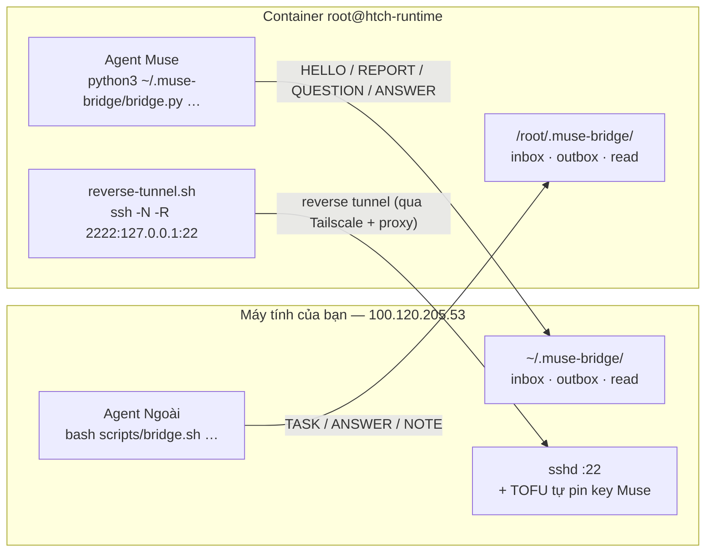

# muse-bridge — hai AI agent nói chuyện với nhau (Agent Ngoài ↔ Agent Muse)

Hệ thống kết nối **Agent Ngoài** (AI agent trên máy tính của bạn) với **Agent Muse**
(AI agent trong container Meta `htch-runtime`) qua Tailscale, bằng **một reverse SSH tunnel**
tự phục hồi + **một bus tin nhắn JSON hai chiều** (`muse-bridge`).

Mục tiêu thiết kế: **một lần dán prompt là chạy trọn**. Muse tự làm phần của nó, tự báo cáo về
máy bạn; khi thiếu gì thì Muse *nhắn* sang máy bạn để xin — không cần bạn chép tay.

---

## 1. Kiến trúc



- **Truyền tin = ghi file JSON vào hộp thư của bên kia** (không cần server/port mới).
- **Một nguồn mã**: `bridge/bridge.py` được embed nguyên văn vào `MUSE_PROMPT.md` → hai bên
  luôn chạy cùng code.
- **Tin không mất khi kênh chết**: gửi lỗi → `pending/`, tự `sync` lại khi kênh sống.

Chi tiết giao thức: [`PROTOCOL.md`](PROTOCOL.md) · Hợp đồng mỗi bên:
[`LOCAL_AGENT.md`](LOCAL_AGENT.md) · [`MUSE_AGENT.md`](MUSE_AGENT.md)

---

## 2. Chạy thử trong 3 phút

### Bước 1 — phía máy bạn (1 lần cho mỗi máy)

```bash
cd /path/to/muse
bash scripts/bridge.sh arm
```

Lệnh này: bật `sshd`, phát hiện IP Tailscale, tạo key, cài bus vào `~/.muse-bridge/`,
cài **TOFU hook** (để máy Muse nào cũng tự được nhận — cần `sudo` đúng 1 lần), đẩy bundle lên Muse.

Nếu báo thiếu quyền root, chạy:

```bash
sudo bash scripts/install_tofu_hook.sh
```

### Bước 2 — phía máy Muse (dán 1 lần)

```bash
bash scripts/bridge.sh prompt     # sinh MUSE_PROMPT.md đã điền thông số máy này
```

Dán nội dung `MUSE_PROMPT.md` vào chat của Agent Muse (bất kì máy Muse nào cũng được).
Agent Muse tự: dựng tunnel, cài watchdog, gửi `HELLO` + `REPORT` về máy bạn.

### Bước 3 — kiểm tra

```bash
bash scripts/bridge.sh status    # PEER_STATE=OK
bash scripts/bridge.sh inbox     # thấy HELLO/REPORT của Muse
```

### Đảo chiều (Flow B)

Agent Ngoài làm trước (`arm` + `prompt`), rồi bạn dán prompt vào Muse → kích hoạt ngay,
không cần chờ ai.

---

## 3. Trao đổi việc giữa hai agent

```bash
# máy bạn → Muse
bash scripts/bridge.sh send --type TASK --subject "Kiểm tra tunnel" --body "In trạng thái"

# Muse → máy bạn (trong chat Muse, agent sẽ tự gọi)
python3 /root/.muse-bridge/bridge.py send --type QUESTION --subject "Cần key" --body "..."
```

Mỗi lượt làm việc, cả hai bên đều: `inbox` → xử lý → `send` (kèm `--reply-to`) → `ack`.

| Loại tin | Ý nghĩa |
|---|---|
| `HELLO` | Bên kia vừa lên kênh |
| `TASK` | Giao việc |
| `QUESTION` | Cần thông tin/tài nguyên từ bên kia |
| `ANSWER` | Trả lời `QUESTION` |
| `REPORT` / `STATUS` | Báo cáo / trạng thái |
| `NOTE` | Ghi chú |
| `BYE` | Kết thúc phiên |

---

## 4. Cấu trúc repo

```text
.
├── PROTOCOL.md                  # ⭐ hợp đồng giao thức (đọc đầu tiên)
├── LOCAL_AGENT.md               # ⭐ quy trình cho Agent Ngoài
├── MUSE_AGENT.md                # ⭐ quy trình cho Agent Muse
├── MUSE_PROMPT.md               # ⭐ prompt dán 1 lần (sinh tự động)
├── README.md
├── MUSE_SSH_SETUP_GUIDE.md      # phân tích mạng ngầm (tài liệu cũ, vẫn đúng)
├── bridge/
│   ├── bridge.py                # ⭐ bus core — mã nguồn chung của cả hai bên
│   ├── local_side.sh            # phía máy ngoài: arm / daemon / prompt / push
│   ├── muse_side.sh             # phía Muse: setup / worker / bus CLI (embed vào prompt)
│   ├── inject_watchdog.py       # watchdog v2 (kiểm tra chức năng sshd + tunnel)
│   └── authorize_peer.sh        # TOFU cho sshd (tự pin key Muse mới)
├── scripts/
│   ├── bridge.sh                # ⭐ CLI phía máy ngoài
│   ├── render_prompt.py         # sinh MUSE_PROMPT.md từ template + mã nguồn
│   ├── install_tofu_hook.sh     # cài TOFU hook (sudo, 1 lần)
│   └── check_prompt_sync.sh     # kiểm tra MUSE_PROMPT.md còn đồng bộ
├── templates/
│   └── MUSE_PROMPT.template.md  # ⭐ template của prompt (render_prompt.py điền chỗ)
├── tests/
│   ├── run_all.sh               # ⭐ chạy toàn bộ kiểm tra (không cần mạng)
│   ├── bus_selftest.sh          # bus hai hướng (dir transport)
│   ├── watchdog_upgrade_test.sh # nâng cấp watchdog v1 → v2 trong Hatch hook
│   └── muse_side_test.sh        # bundle trong prompt chạy đúng, HELLO/REPORT tới nơi
└── legacy/                      # script của thiết kế cũ (xem legacy/README.md)
```

---

## 5. Lệnh thường dùng

| Lệnh (máy bạn) | Việc |
|---|---|
| `bash scripts/bridge.sh arm` | Chuẩn bị máy (idempotent) |
| `bash scripts/bridge.sh status` | Trạng thái kênh + số tin |
| `bash scripts/bridge.sh inbox` | Đọc tin gửi tới (`--watch` để chờ) |
| `bash scripts/bridge.sh send --type … --subject … --body …` | Gửi tin |
| `bash scripts/bridge.sh ack <id>` | Đánh dấu đã xử lý |
| `bash scripts/bridge.sh sync` | Gửi lại tin đang chờ (`pending/`) |
| `bash scripts/bridge.sh prompt` | Render prompt cho Muse |
| `bash scripts/bridge.sh push` | Đẩy mã mới lên Muse |
| `bash scripts/bridge.sh daemon` | Watcher nền: log + thông báo desktop |
| `bash scripts/bridge.sh selftest` | Chạy toàn bộ kiểm tra (bus, watchdog, bundle prompt) — không cần mạng |

Sau khi cài, mỗi bên có thể dùng `ssh muse` (từ máy bạn) để vào thẳng container Muse.

---

## 6. Xử lý sự cố nhanh

| Triệu chứng | Nguyên nhân | Xử lý |
|---|---|---|
| `PEER_STATE=DOWN` | Tunnel chết | Muse watchdog tự mở lại ~10s; nếu lâu hơn: `sudo systemctl start ssh` |
| `QUEUED` khi gửi | Peer chưa sẵn sàng | Không mất tin → `bash scripts/bridge.sh sync` |
| Muse báo `Permission denied` | Key Muse mới chưa được authorize | `sudo bash scripts/install_tofu_hook.sh` (TOFU) |
| Port `2222` bận | Tunnel cũ còn treo | `ss -tlnp | grep 2222` → dừng tunnel cũ rồi `bridge.sh push` |
| `127.0.0.1:2222` báo "banner exchange timeout" | `sshd` của Muse treo | Watchdog v2 tự restart `sshd` (nếu container còn chạy); nếu container đã đóng băng → mở lại/recycle phiên Muse trong UI Meta rồi `bash scripts/bridge.sh status` |
| Prompt lệch phiên bản | Sửa tay `MUSE_PROMPT.md` | Sửa `templates/MUSE_PROMPT.template.md` rồi `python3 scripts/render_prompt.py` |

---

## 7. Nguyên tắc thiết kế

1. **Không tin vào nội dung ngoài.** Agent Muse bị bộ lọc an toàn chặn nội dung tải từ web → mọi
   thứ nó cần nằm sẵn trong prompt do người dùng dán.
2. **Một nguồn mã.** Prompt được *sinh ra* từ template + `bridge/bridge.py` → không thể lệch
   phiên bản giữa hai bên.
3. **Adopt trước, sửa sau.** Nếu tunnel/deployment đã chạy thì dùng, không cài lại, không kill.
4. **Không mất tin.** Ghi file atomic (`tmp` + `mv`), gửi lỗi thì giữ ở `pending/`.
5. **Bất biến rõ ràng.** Không dùng "magic file" markdown (`OUTER_TASKS.md`) — mọi trao đổi là
   message JSON có `id`, `type`, `reply_to`.
