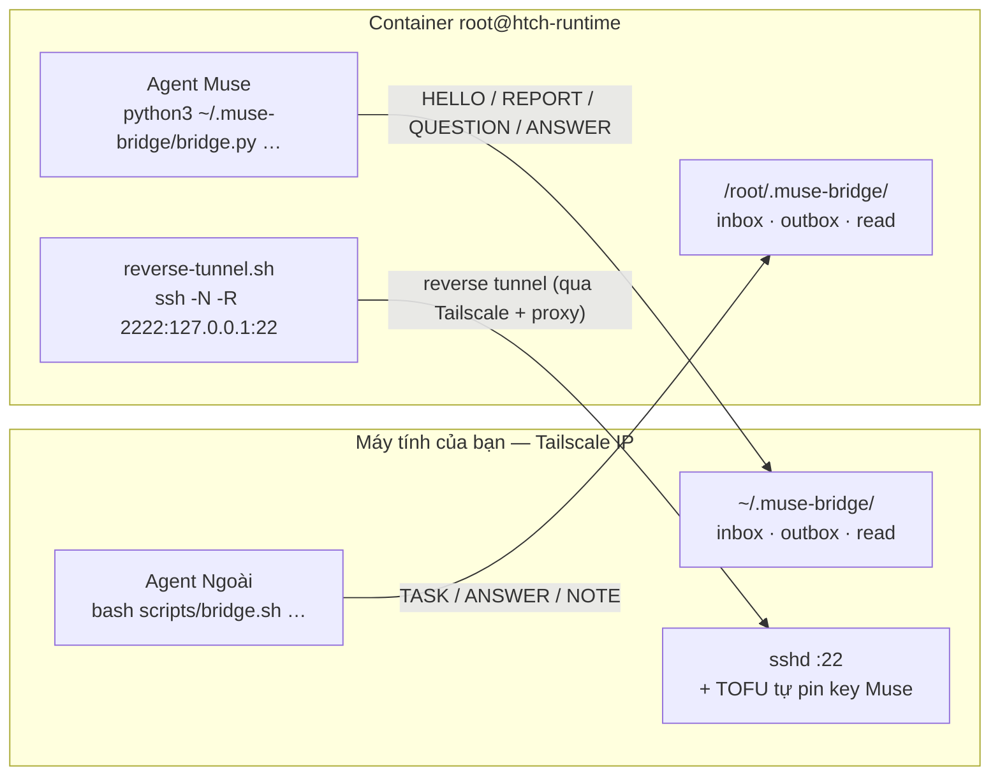

# muse-bridge — hai AI agent nói chuyện với nhau (Agent Ngoài ↔ Agent Muse)

Hệ thống kết nối **Agent Ngoài** (AI agent trên máy tính của bạn) với **Agent Muse**
(AI agent trong container Meta `htch-runtime`) qua Tailscale, bằng **một reverse SSH tunnel**
tự phục hồi + **một bus tin nhắn JSON hai chiều** (`muse-bridge`).

Mục tiêu thiết kế: **một lần dán prompt là chạy trọn**. Muse tự làm phần của nó, tự báo cáo về
máy bạn; khi thiếu gì thì Muse *nhắn* sang máy bạn để xin — không cần bạn chép tay.

---

## 1. Kiến trúc



- **Truyền tin = ghi file JSON vào hộp thư của bên kia** (không cần server/port mới).
- **Một nguồn mã**: `bridge/bridge.py` được embed nguyên văn vào `MUSE_PROMPT.md` → hai bên
  luôn chạy cùng code.
- **Tin không mất khi kênh chết**: gửi lỗi → `pending/`, tự `sync` lại khi kênh sống.

Chi tiết giao thức: [`PROTOCOL.md`](PROTOCOL.md) · Hợp đồng mỗi bên:
[`LOCAL_AGENT.md`](LOCAL_AGENT.md) · [`MUSE_AGENT.md`](MUSE_AGENT.md)

---

## 2. Chạy thử trong 3 phút

### Bước 1 — phía máy bạn (1 lần cho mỗi máy)

```bash
cd /path/to/muse
bash scripts/bridge.sh arm
```

Lệnh này: bật `sshd`, phát hiện IP Tailscale, tạo key, cài bus vào `~/.muse-bridge/`,
cài **TOFU hook** (để máy Muse nào cũng tự được nhận — cần `sudo` đúng 1 lần), đẩy bundle lên Muse.

Nếu báo thiếu quyền root, chạy:

```bash
sudo bash scripts/install_tofu_hook.sh
```

Thêm 1 lệnh nữa (cũng `sudo`, chạy 1 lần) để sshd **tự đóng session treo** — nếu không, một
container bị đóng băng sẽ giữ chết port forward `2222`/`2223` và container mới không bind được:

```bash
sudo bash scripts/install_sshd_keepalive.sh
```

> Dùng skill `/setup-ssh-muse` (Cách 1 ở Bước 2) thì **agent tự lo 2 lệnh sudo này**: nó tự cài
> được bằng `sudo -n` thì cài luôn, cần mật khẩu thì đưa bạn đúng 1 lệnh rồi xác minh lại bằng
> `doctor`. Ở đây (làm tay) thì bạn chạy trước cho khỏe.

### Bước 2 — kết nối một máy Muse MỚI

Repo có **một prompt duy nhất** (`.agents/setup-ssh-muse/reference/MUSE_PROMPT.template.md`): chứa sẵn Tailscale
IP, user, port, public key, đường dẫn bundle, proxy, key path bền vững + **7 bước** bootstrap +
hợp đồng **"không hỏi lại, tự đi tiếp, tự báo status block"**. Dán một lần là xong.

**Cách 1 — Claude Code (khuyên dùng): skill `/setup-ssh-muse`**

Gõ:

```
/setup-ssh-muse
```

Agent sẽ:

1. **Tự cài điều kiện tiên quyết**: kiểm tra & cài Tailscale, `sshd`, TOFU hook, sshd keepalive.
   Phần nào tự cài được (qua `sudo -n`) thì agent tự cài; phần nào cần **mật khẩu sudo** thì agent
   đưa bạn **đúng 1 lệnh** và hỏi, sau đó **chạy lại `doctor` để xác minh bằng file thật**.
2. **Hỏi bạn vài câu** (click được): tên SSH alias (mặc định `muse-001`, nếu đã có thì kê tiếp
   `muse-002`…), cổng forward, profile Chrome.
3. **Đăng ký host** (`arm` + `add-host`) → `ssh <alias>` là vào được ngay sau khi xong.
4. **Sinh `setup_prompt.md`** ở gốc repo (bản copy của prompt đã điền thông số máy bạn) — file
   này **gitignore**, đừng commit.
5. Hỏi bạn: **tự dán** hay để **agent tự dán** (zero-touch — `bridge.sh onboard`, bạn không
   phải paste gì).
6. Nếu bạn tự dán: agent **DỪNG**, bạn copy file → dán vào chat **mới** của máy Muse. Muse làm
   xong sẽ báo **status block** (7 dòng `MUSE_HOST`, `MUSE_KEY`, `MUSE_PUBKEY`,
   `MUSE_TUNNEL_PORT`, `MUSE_TUNNEL`, `MUSE_PERSISTENCE`, `MUSE_PROBE`) → bạn **paste nguyên
   block** vào lại đây.
7. Agent đọc block đó: authorize key của container, đẩy bundle, chờ `PEER_STATE=OK`, rồi
   xác nhận bằng `ssh -o BatchMode=yes <alias> 'echo SSH_OK'` → **xong**, bạn `ssh <alias>`.

Session bị ngắt giữa chừng thì gọi lại `/setup-ssh-muse --resume <alias>` — trạng thái nằm ở
`.muse-hosts/<alias>/setup_state.json`.

Skill: [`.agents/setup-ssh-muse/SKILL.md`](.agents/setup-ssh-muse/SKILL.md) ·
test: `tests/setup_command_test.sh`.

**Cách 2 — thủ công**

```bash
bash scripts/bridge.sh add-host --host muse4 --port 2225   # (nếu chưa đăng ký host)
bash scripts/bridge.sh prompt --host muse4                  # render .muse-hosts/muse4/MUSE_PROMPT.md
bash scripts/bridge.sh prompt --host muse4 --print          # in ra để copy
bash scripts/bridge.sh prompt --host muse4 --clip           # copy vào clipboard
bash scripts/bridge.sh prompt --host muse4 --send           # tự dán vào chat Muse qua driver web
```

Dán nguyên file vào chat **mới** của Agent Muse → Muse tự: cài key → bảo đảm `sshd` → tạo proxy →
**tự kéo bundle** từ máy bạn qua SSH → dựng tunnel + systemd `Restart=always` + watchdog 15s →
tự kiểm tra → báo status block. Không cần trả lời câu hỏi nào của nó.

**Cách 3 — zero-touch (agent tự dán qua trình duyệt)**

```bash
bash scripts/bridge.sh onboard --host muse4
```

`onboard` làm trọn vẹn: render prompt (đúng port) → điều khiển Chrome đã đăng nhập `muse.ai` để tạo
chat mới và gửi prompt → **tự bấm Allow** cho các hộp phê duyệt → chờ Agent Muse báo **status
block** → authorize key của container → chờ tunnel lên → **đẩy bus + watchdog + deb cache vào
container** → xác nhận `PEER_STATE=OK`.

> **Vì sao prompt không chứa mã nguồn?** Bộ lọc an toàn của nền tảng Muse đã từ chối chạy "khối
> script lớn" dán vào chat (05/11, 06/11). Vì vậy prompt chỉ có các lệnh ngắn; toàn bộ mã bus được
> **kéo từ máy bạn qua kênh SSH đã xác thực** (Bước 4 của prompt). Chi tiết: `PROTOCOL.md` mục 8.1.

### Bước 3 — kiểm tra

```bash
bash scripts/bridge.sh hosts                  # các Muse host đang quản lý
bash scripts/bridge.sh status --host muse2    # PEER_STATE=OK
bash scripts/bridge.sh inbox --host muse2     # thấy HELLO/REPORT của Muse
```

### Nhiều máy Muse trên cùng một máy

Mỗi Muse host một cổng riêng (`2222`, `2223`, …), một SSH alias riêng (`ssh muse`, `ssh muse2`) và
một spool riêng. Thông tin kết nối lưu ở **`~/.muse-bridge/hosts/<id>.json`** (runtime, ngoài repo)
— có trên máy bạn, không push lên Git. `.muse-hosts/<id>/` trong repo (gitignored) chỉ chứa
artifact: prompt render, `setup_state.json`, log driver web.

### Nhiều tài khoản Muse (khác account Chrome)

Mỗi tài khoản Muse đăng nhập trong một **Chrome profile riêng**. Driver web chỉ clone được cookie
của profile đó, nên host mới phải khai báo profile cần dùng:

```bash
bash scripts/bridge.sh add-host --host muse3 --port 2224 --profile-dir "Profile 2"
bash scripts/bridge.sh onboard --host muse3
```

Xem profile nào đang có account Muse đăng nhập (tên + email + host nào đang dùng):

```bash
bash scripts/bridge.sh profiles            # bảng đầy đủ
bash scripts/bridge.sh profiles --json     # cho agent parse
```

Cột `LOGGED_IN=yes` = profile đó còn cookie muse.ai sống (còn đăng nhập). Cột `USED_BY` = host nào
đang dùng profile đó. Bỏ `--profile-dir` thì dùng `Default`.

Mỗi host có **CDP port và clone dir riêng** (ghi trong `~/.muse-bridge/hosts/<id>.json`: `web_cdp_port`,
`web_clone_dir`) → chạy song song nhiều host, mỗi host một Chrome clone độc lập, không đụng nhau.

### Đảo chiều (Flow B)

Agent Ngoài làm trước (`arm` + `prompt`), rồi bạn dán prompt vào Muse → kích hoạt ngay,
không cần chờ ai.

---

## 3. Trao đổi việc giữa hai agent

```bash
# máy bạn → Muse
bash scripts/bridge.sh send --type TASK --subject "Kiểm tra tunnel" --body "In trạng thái"

# Muse → máy bạn (trong chat Muse, agent sẽ tự gọi)
python3 /root/.muse-bridge/bridge.py send --type QUESTION --subject "Cần key" --body "..."
```

Mỗi lượt làm việc, cả hai bên đều: `inbox` → xử lý → `send` (kèm `--reply-to`) → `ack`.

| Loại tin | Ý nghĩa |
|---|---|
| `HELLO` | Bên kia vừa lên kênh |
| `TASK` | Giao việc |
| `QUESTION` | Cần thông tin/tài nguyên từ bên kia |
| `ANSWER` | Trả lời `QUESTION` |
| `REPORT` / `STATUS` | Báo cáo / trạng thái |
| `NOTE` | Ghi chú |
| `BYE` | Kết thúc phiên |

---

## 4. Cấu trúc repo

```text
.
├── AGENTS.md                    # ⭐ bản đồ repo (đọc file nào cho việc nào)
├── PROTOCOL.md                  # ⭐ hợp đồng giao thức (đọc đầu tiên)
├── CODING_STANDARDS.md          # ⭐ tiêu chuẩn code cho reviewer
├── LOCAL_AGENT.md               # ⭐ quy trình cho Agent Ngoài
├── MUSE_AGENT.md                # ⭐ quy trình cho Agent Muse
├── README.md
├── MUSE_PROMPT.md               # prompt dán 1 lần — SINH TỰ ĐỘNG, gitignored (chứa key/IP máy bạn)
├── bridge/
│   ├── bridge.py                # ⭐ bus core — mã nguồn chung của cả hai bên
│   ├── local_side.sh            # phía máy ngoài: hosts / arm / onboard / daemon / push / repair
│   ├── muse_side.sh             # phía Muse: setup / worker / bus CLI (được đẩy vào container)
│   ├── muse_web.py              # ⭐ điều khiển Chrome (CDP thuần Python) để gửi prompt + bấm Allow
│   ├── reverse-tunnel.sh        # loop tự reconnect tunnel (mỗi port một bản + config riêng)
│   ├── ts-socat-proxy.sh        # nối qua HTTP CONNECT proxy của Hatch (có đường cứu)
│   ├── ts-connect-proxy.py      # cùng việc, viết bằng python (dùng khi container thiếu socat)
│   ├── inject_watchdog.py       # watchdog v7 (sshd + key + unit + HATCH_HOOK_RESULT; probe banner bằng python3)
│   ├── authorize_peer.sh        # TOFU cho sshd (tự pin key Muse mới)
│   └── muse-bridge-daemon.service  # unit systemd user cho daemon nền
├── scripts/
│   ├── bridge.sh                # ⭐ CLI phía máy ngoài
│   ├── render_prompt.py         # sinh MUSE_PROMPT.md từ template
│   ├── chrome_profiles.py       # liệt kê Chrome profile + profile nào còn đăng nhập muse.ai
│   ├── install_tofu_hook.sh     # cài TOFU hook (sudo, 1 lần)
│   ├── install_sshd_keepalive.sh # sshd tự đóng session treo (sudo, 1 lần)
│   ├── update_host_state.py     # cập nhật trạng thái trong .muse-hosts/<id>/card.json
│   ├── check_prompt_sync.sh     # kiểm tra template + MUSE_PROMPT.md còn đồng bộ
│   └── check_hygiene.sh         # quét IP/email/path riêng của máy + TODO/stub
├── .agents/                      # ⭐ nguồn thật của mọi skill (trung cho MỌI agent tool)
│   └── setup-ssh-muse/
│       ├── SKILL.md              # ⭐ skill /setup-ssh-muse: tự cài điều kiện tiên quyết → hỏi → sinh setup_prompt.md → chờ paste → xong
│       └── reference/
│           └── MUSE_PROMPT.template.md  # ⭐ PROMPT DUY NHẤT của repo (7 bước, KHÔNG chứa mã bus)
├── .claude/
│   └── skills -> ../.agents      # symlink: Claude Code đọc skill từ .agents/ (1 nguồn, không copy)
├── tests/
│   ├── run_all.sh               # ⭐ chạy toàn bộ kiểm tra (không cần mạng)
│   ├── bus_selftest.sh          # bus hai hướng (dir transport)
│   ├── watchdog_upgrade_test.sh # nâng cấp watchdog trong Hatch hook (idempotent)
│   ├── muse_side_test.sh        # bundle phía Muse + config per-port
│   ├── sshd_config_guard_test.sh# tự phục hồi sshd_config bị platform xoá/ghi đè
│   ├── tunnel_loop_test.sh      # vòng lặp tunnel + proxy helper (stub, không cần container)
│   ├── forward_release_test.sh  # giải phóng đúng forward port (không kill session người khác)
│   ├── daemon_log_test.sh       # log daemon: lọc dòng rỗng, gộp dòng lặp, giới hạn kích thước
│   ├── strict_modes_test.sh     # authorized_keys: copy, không symlink
│   ├── hosts_test.sh            # đăng ký nhiều host: port, alias, spool, prompt
│   ├── host_card_test.sh        # card host: cập nhật không mất trường cũ
│   ├── prompt_test.sh           # prompt duy nhất: render + bash -n từng khối + proxy helper
│   ├── setup_command_test.sh    # skill /setup-ssh-muse: 7 chặng + status block 7 dòng + gitignore
│   ├── muse_web_profile_test.sh # driver web clone đúng Chrome profile (multi-account)
│   ├── tunnel_pattern_test.sh   # phát hiện tunnel không phụ thuộc thứ tự flag ssh
│   └── selfheal_test.sh         # test THẬT (cần container): tự phục hồi khi tunnel bị giết
├── .github/workflows/ci.yml     # CI: chạy selftest khi push
├── .githooks/pre-commit         # hook: chạy selftest trước mỗi commit
└── .gitignore                   # artifact sinh ra + runtime state KHÔNG vào git
```

### 4.1 Script của thiết kế cũ (v1) — đã xoá

Thiết kế đầu tiên (`muse-auto-ssh v1`) có bộ script riêng; nay đã bị thay toàn bộ bằng `bridge/` và
đã xoá khỏi repo. Vẫn đọc lại được từ lịch sử git: `git log --diff-filter=D -- legacy/README.md`.
Bảng đối chiếu v1 → v2:

| Script cũ (v1) | Được thay bằng |
|---|---|
| `muse_bootstrap.sh` | `bridge/muse_side.sh setup` (tự dò `BASE`, tự cài socat/sshd, tự sinh key) |
| `muse_start_tunnel.sh` | `bridge/muse_side.sh setup` (adopt-first, không kill tunnel cũ) |
| `muse_remote_sync.sh` | `bridge/muse_side.sh setup` + `bridge/muse_side.sh worker` |
| `muse_harden_persistence.sh` | watchdog Hatch trong `bridge/muse_side.sh` (`ensure_persistence`) |
| `local_setup.sh` | `bash scripts/bridge.sh arm` |
| `local_finalize_persistence.sh` | `bash scripts/bridge.sh arm` (đã push bundle + cài TOFU) |
| `outer_bridge.sh` | `bash scripts/bridge.sh status` / `inbox` |
| `reverse-tunnel-g3.sh` | script loop do `muse_side.sh` sinh ra (`$BASE/tunnel/reverse-tunnel.sh`) |
| `templates/` | proxy + loop + systemd đã được nhúng thẳng vào `bridge/muse_side.sh`; prompt nay nằm trong skill (`.agents/setup-ssh-muse/reference/`) |

Mailbox kiểu cũ (`~/muse-bridge/MUSE_STATUS.md`, `OUTER_TASKS.md`) **không còn dùng** — trao đổi
giữa hai agent giờ đi qua bus tin nhắn JSON (`muse-bridge`), xem `PROTOCOL.md` mục 5–7.

---

## 5. Lệnh thường dùng

| Lệnh (máy bạn) | Việc |
|---|---|
| `bash scripts/bridge.sh hosts` | Liệt kê Muse host đang quản lý |
| `bash scripts/bridge.sh profiles` | Liệt kê Chrome profile + profile nào còn đăng nhập muse.ai (tên, email, host đang dùng) |
| `bash scripts/bridge.sh add-host --host <id>` | Đăng ký Muse host mới (port, ssh alias, spool) |
| `bash scripts/bridge.sh set-port --host <id> --port <p>` | Đổi port host đã đăng ký (config + card + ssh alias), **không** ghi lại card |
| `bash scripts/bridge.sh rename --host <id> --new-id <id-moi>` | Đổi tên host — chuẩn: theo **tên đã đặt cho Muse** (vd `muse-tampt`), chưa đặt tên thì `muse-<local-part email>` (config + spool + folder card + ssh alias; port và tin nhắn giữ nguyên) |
| `bash scripts/bridge.sh remove-host --host <id>` | Gỡ đăng ký host trùng/chết (giữ spool tin nhắn + lịch sử card `.removed/`); dừng tunnel trong container trước khi gỡ |
| `bash scripts/bridge.sh add-host --host <id> --profile-dir "Profile 2"` | Như trên, nhưng host dùng Chrome profile (account) khác `Default` |
| `bash scripts/bridge.sh arm` | Chuẩn bị máy (idempotent) |
| `bash scripts/bridge.sh onboard --host <id>` | Zero-touch: tự dán prompt vào web Muse + chờ kênh thông |
| `bash scripts/bridge.sh status` | Trạng thái kênh + số tin |
| `bash scripts/bridge.sh inbox` | Đọc tin gửi tới (`--watch` để chờ) |
| `bash scripts/bridge.sh send --type … --subject … --body …` | Gửi tin |
| `bash scripts/bridge.sh ack <id>` | Đánh dấu đã xử lý |
| `bash scripts/bridge.sh sync` | Gửi lại tin đang chờ (`pending/`) |
| `bash scripts/bridge.sh pull` | Kéo tin từ peer (khi chỉ còn 1 chiều) |
| `bash scripts/bridge.sh prompt --host <id>` | Render prompt cho Muse (prompt duy nhất của repo) — `--print` / `--clip` / `--send` |
| `bash scripts/bridge.sh push` | Đẩy mã mới lên Muse |
| `bash scripts/bridge.sh provision --host <id>` | Đẩy bus + watchdog + chạy setup phía Muse |
| `bash scripts/bridge.sh doctor` | Chẩn đoán: sshd, TOFU hook, từng host |
| `bash scripts/bridge.sh health` | Theo dõi container: thời gian sống, số lần restart, RAM, spool, thư mục bền vững (ghi mẫu vào `~/.muse-bridge/health/<id>/samples.jsonl`) |
| `bash scripts/bridge.sh repair --host <id>` | Đánh thức container Muse bị đóng băng qua web (gửi vào **chat riêng** của host) |
| `bash scripts/bridge.sh chat --host <id>` | Chat riêng của bridge cho host (`/thread/<uuid>`, lưu trong card) — tạo mới nếu chưa có |
| `bash scripts/bridge.sh daemon` | Watcher nền: log + thông báo desktop |
| `bash scripts/bridge.sh selftest` | Chạy toàn bộ kiểm tra (bus, watchdog, bundle prompt, shellcheck, ruff) — không cần mạng |

Mọi lệnh bus nhận `--host <id>` (bỏ trống → host mặc định).

Ngoài các lệnh trên, Claude Code có sẵn 1 skill trong repo:
`.agents/setup-ssh-muse/SKILL.md` (`/setup-ssh-muse` — hỏi → sinh `setup_prompt.md` →
chờ bạn paste status block → hoàn tất, xem Bước 2'').

Sau khi cài, mỗi bên có thể dùng `ssh muse` (từ máy bạn) để vào thẳng container Muse.

---

## 6. Xử lý sự cố nhanh

| Triệu chứng | Nguyên nhân | Xử lý |
|---|---|---|
| `PEER_STATE=DOWN` | Tunnel chết | Muse watchdog tự mở lại ~10s; nếu lâu hơn: `sudo systemctl start ssh` |
| `QUEUED` khi gửi | Peer chưa sẵn sàng | Không mất tin → `bash scripts/bridge.sh sync` (hoặc `pull` nếu chỉ còn 1 chiều) |
| Muse báo `Permission denied` | Key Muse mới chưa được authorize | `sudo bash scripts/install_tofu_hook.sh` (TOFU) |
| Port `2222` bận | Tunnel cũ còn treo | `ss -tlnp | grep 2222` → dừng tunnel cũ rồi `bridge.sh push` |
| `127.0.0.1:2222` báo "banner exchange timeout" | `sshd` của Muse treo, hoặc container đã đóng băng | Watchdog v8 tự restart `sshd` (nếu container còn chạy); nếu container đã đóng băng hoàn toàn → `bash scripts/bridge.sh repair --host <id>` (đánh thức qua web, cần `MUSE_WAKE_ALLOW=1`) |
| Container báo "remote port forwarding failed for listen port 2222" | Session ssh cũ còn treo trên máy ngoài và đang giữ port | `bash scripts/bridge.sh release --host <id>` (dừng đúng session giữ port); lâu dài: `sudo bash scripts/install_sshd_keepalive.sh` (1 lần) để sshd tự đóng session treo |
| Container báo "remote port forwarding failed" **liên tục mỗi 15s** | Có **hai** supervisor cùng mở 1 port (ví dụ Agent Muse tự viết thêm script tunnel trong `/root/.ssh/`) | Trong container: `pgrep -af "ssh .*-R <port>:"` → dừng script thừa, chỉ giữ `/home/hatch/workspace/muse-platform-setup/tunnel/reverse-tunnel-<port>.sh` |
| Web driver mở ra trang "Log in" của muse.ai | Clone Chrome đổi tên profile (`Profile 2` → `Default`) nên mất phiên đăng nhập | Clone phải **giữ nguyên tên profile** và mở bằng `--profile-directory` (xem `bridge/muse_web.py`) |
| Container mới không tới được máy bạn (proxy đóng CONNECT tới IP Tailscale) | Container chưa có node Tailscale | Agent sẽ tạo link `login.tailscale.com` → bạn đăng nhập + duyệt node → container có IP tailnet riêng |
| Container bị đóng băng, không tiến trình nào chạy | Nền tảng suspend/checkpoint container | `bash scripts/bridge.sh repair --host <id>` — gửi tin vào **chat riêng của host** (card `thread`) để đánh thức; daemon tự làm mỗi 5 phút |
| Muse không đăng nhập được vào máy mình | `sshd` trong container đọc `/root/.ssh/authorized_keys`, không phải `~/.ssh/authorized_keys` của user `hatch` | Ghi key vào **cả hai** file (prompt mới đã làm sẵn) |
| Container không ra ngoài thẳng được | Phải qua HTTP CONNECT proxy `hatch-egress-proxy` cổng **3130** (không cần user:pass) | Dùng `bridge/ts-socat-proxy.sh` — đừng điền tay `USER:PASS` |
| `Permission denied (publickey,password)` khi SSH ra ngoài | `ssh` không tìm thấy private key của container | Thêm `-i /home/hatch/.ssh/id_ed25519` (key không nằm ở `/root/.ssh/`) |
| Key của máy bạn biến mất sau khi container refresh | `/root` bị xoá khi refresh | Key gốc nằm ở `/home/hatch/.ssh/authorized_keys` và được **copy** sang `/root/.ssh/authorized_keys` (chmod 600). **Không symlink** — `/home/hatch` group-writable → `sshd` `StrictModes` từ chối key → `Permission denied` |
| Prompt lệch phiên bản | Sửa tay `MUSE_PROMPT.md` | Sửa `.agents/setup-ssh-muse/reference/MUSE_PROMPT.template.md` rồi `python3 scripts/render_prompt.py` |
| `selftest` FAIL trên máy khác | Test còn đọc trạng thái thật của máy | Báo lại — test phải hermetic (xem `CODING_STANDARDS.md` mục 6) |

### 6.1. Container bị refresh — mất gì, giữ gì?

Container Muse do nền tảng **xoay vong** (refresh) không báo trước: mỗi lần refresh, toàn bộ
`/` (overlay 7.5G) và `/tmp` bị xoá và dựng lại. Đây là hành vi bình thường của nền tảng, không
phải lỗi — nên phải **thiết kế cho nó**, đừng cố ngăn.

| Nằm ở đâu | Còn sau refresh? |
|---|---|
| `/home/hatch` (150G, `/dev/mapper/rv`) | ✅ còn — mọi thứ bên trong đều bền |
| `/root/.muse-bridge` | ✅ còn — nó là **symlink** → `/home/hatch/.muse-bridge`, nên **spool tin nhắn không mất** |
| `/root/.ssh` | ❌ mất → được `provision` copy lại từ `/home/hatch/.muse-bridge/authorized_keys.seed` |
| `/etc/ssh/ssh_host_*` | ❌ mất → được copy lại từ `/home/hatch/.muse-bridge/ssh_host/` (nếu không, fingerprint đổi) |
| `/tmp`, `/var`, `/usr` | ❌ mất |
| Tiến trình đang chạy (job, tunnel, sshd) | ❌ chết — container mới lên, phải tự mở lại |

Phía máy bạn tự phục hồi trong ~2 phút: daemon nền thấy container refresh → `auto-reprovision`
(bus + watchdog + loop tunnel + systemd) qua SSH. Tin nhắn đang chờ không mất (spool bền) —
nhưng **job đang chạy thì chết**, và dữ liệu nằm ngoài `/home/hatch` cũng chết theo.

#### 6.1.1. Khi cell bị pause/refresh giữa chừng — SSH có tự lên không?

**Có, và không cần chat.** Supervisor của tunnel là **systemd (PID 1)** — nó sống qua lúc nền tảng
pause agent session (hook của Hatch thì không: hook là tiến trình con của agent session, chết theo).

| Việc | Kết quả đo được trên cell thật |
|---|---|
| Giết cả loop tunnel **và** `sshd` (mô phỏng platform giết session) | Port ngoài (`127.0.0.1:<port>`) nhận lại **sau 19 s** — không chat, không wake |
| `systemctl status muse-reverse-tunnel-<port>.service` | `active (running)`, `Main PID` = loop, `CGroup: /system.slice/…` |
| `pgrep -af "ssh .*-R <port>:"` | **đúng 1 dòng** (đừng để hai supervisor tranh port) |

Nguyên tắc: **supervisor phải sống lâu hơn thứ nó giám sát**. Loop tunnel phải là `ExecStart` của
unit systemd (`Restart=always`, `RestartSec=5`, `StartLimitIntervalSec=0`), **không** được chạy bằng
`nohup` từ hook. Chi tiết và nguyên nhân gốc: `PROTOCOL.md` mục 8.2–8.3.

> `MUSE_WAKE_ALLOW` (đánh thức cell qua chat) **mặc định tắt** và không cần bật: lớp tự phục hồi
> của cell đã đủ để SSH tự lên. Lớp đó chỉ hữu ích khi cell **đã đóng băng hoàn toàn** — lúc đó
> không tiến trình nào trong container chạy.

#### 6.1.2. Sửa xong trong repo — làm sao để cell nhận được?

Container **không** tự thấy commit của bạn. Nó kéo bundle qua file `VERSION`; bundle local chỉ
được làm mới khi `arm`/`push`/`provision`. Nên có daemon local tự làm việc này:

```bash
# mặc định BẬT: HEAD đổi + cây git sạch -> refresh bundle + đẩy lên các host đang kết nối
MUSE_AUTO_DEPLOY=1     # tắt: MUSE_AUTO_DEPLOY=0
```

Daemon cũng tự dò mỗi 30 s (`WATCH_INTERVAL`). Nếu bạn sửa xong mà **không** muốn đẩy lên cell
(lỡ tay sửa dở), cứ để cây git **bẩn** — auto-deploy sẽ bỏ qua, đừng commit nhầm.

Xem số lần restart và thời gian sống thực tế:

```bash
bash scripts/bridge.sh health                    # 1 lần, in bảng + ghi 1 mẫu
# hoặc cài timer 5 phút/lần:
REPO="$(cd "$(dirname "${BASH_SOURCE[0]}")/.." && pwd)"
mkdir -p ~/.config/systemd/user
sed "s#%h/Documents/muse#$REPO#g" bridge/muse-bridge-health.service > ~/.config/systemd/user/muse-bridge-health.service
cp bridge/muse-bridge-health.timer ~/.config/systemd/user/
systemctl --user daemon-reload && systemctl --user enable --now muse-bridge-health.timer
```

Mẫu lưu ở `~/.muse-bridge/health/<id>/samples.jsonl`; `boot_id` đổi = 1 lần restart.

**Đẩy việc nặng sang container Muse** (`roff` — skill `remote-offload`): layout của `roff` nằm
ở `$ROFF_ROOT`; khi host có thư mục bền vững (Muse: `/home/hatch`) thì `roff` tự dùng
`/home/hatch/.roff` → **project đã push và output của job còn nguyên sau refresh**. Việc đang
chạy vẫn chết (exit 69) → `roff pull` phần output còn lại rồi submit lại, **không** phải push
lại. Lưu ý RAM: container Muse thường chỉ còn ~600 MB trống → job nặng dễ bị OOM-kill.

---

## 7. Guardrail — kiểm tra trước khi bàn giao

```bash
bash scripts/bridge.sh selftest      # toàn bộ test offline + shellcheck + ruff
```

Phải in `ALL TESTS: PASS`. Cài thêm tool nếu báo thiếu:

```bash
pip install --user ruff shellcheck-py
```

Bật pre-commit hook (chạy selftest trước mỗi commit):

```bash
git config core.hooksPath .githooks
```

CI (`.github/workflows/ci.yml`) chạy `tests/run_all.sh --strict` + `check_prompt_sync.sh --strict` —
tức là kiểm tra **không phụ thuộc máy đang chạy**, nên phải xanh trên mọi clone.

---

## 8. Nguyên tắc thiết kế

1. **Không tin vào nội dung ngoài.** Agent Muse bị bộ lọc an toàn chặn nội dung tải từ web → mọi
   thứ nó cần nằm sẵn trong prompt do người dùng dán.
2. **Một nguồn mã.** Prompt được *sinh ra* từ template + `bridge/bridge.py` → không thể lệch
   phiên bản giữa hai bên.
3. **Adopt trước, sửa sau.** Nếu tunnel/deployment đã chạy thì dùng, không cài lại, không kill.
4. **Không mất tin.** Ghi file atomic (`tmp` + `mv`), gửi lỗi thì giữ ở `pending/`.
5. **Bất biến rõ ràng.** Không dùng "magic file" markdown (`OUTER_TASKS.md`) — mọi trao đổi là
   message JSON có `id`, `type`, `reply_to`.
6. **Chạy được ở máy khác.** Không hard-code IP/user/path của một máy cụ thể; mọi thứ lấy từ
   runtime config (`tunnel-<port>.conf`, `.muse-hosts/<id>/card.json`) hoặc auto-detect.
